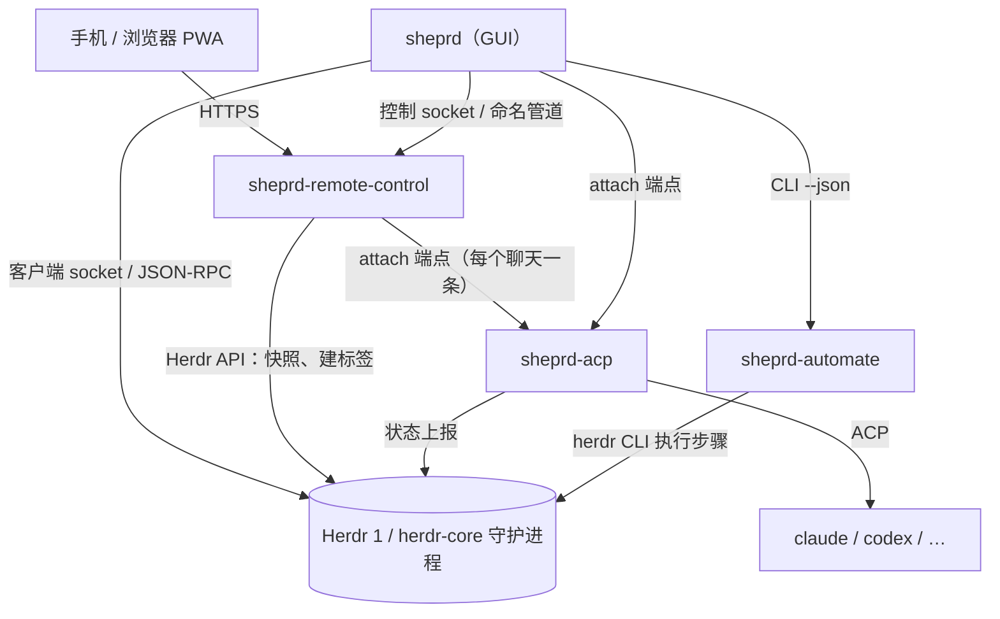

# 二进制程序

Sheprd 会构建四个可执行程序。其中一个是桌面应用本体，另外三个是它按需拉起、且能比它活得更久的独立进程。终端进程与会话状态归守护进程所有，因此关掉窗口并不会结束它们。

`just build-release` 会一并构建应用、`sheprd-acp`、`sheprd-automate` 与 `sheprd-remote-control`（含默认的 `server` feature）。下文体积取自一次 Windows x64 release 构建，并非固定契约。

## `sheprd.exe` — 桌面应用本体（95.3 MiB）

- GPUI 原生界面：工作区、worktree、标签与分屏，由守护进程单元格绘制的终端，与 Agent 的聊天，评审、拉取请求、浏览器预览、用量、mods 与 Automations 区块。
- 终端有两种来源：Herdr 1 提供单元格；herdr-core 提供原始字节，由 `sheprd-terminal` 在本地模拟。
- 同一可执行文件也是命令行。`sheprd COMMAND` 通过私有控制 socket（Windows 上为命名管道）驱动正在运行的窗口，负责只有本客户端知晓的内容：页面、代码、评审、Devices 与设置。工作区、标签、面板和 Agent 仍归 Herdr 自己的 `herdr` CLI。参见 [cli.md](cli.md)。
- 需要时启动本地 Herdr 守护进程，但绝不安装、停止或升级它。退出只关闭界面，守护进程与终端继续运行。
- 在自身可执行文件旁查找伴生程序（`sheprd-acp`、`sheprd-automate`、`sheprd-nearby`、`sheprd-remote-control`），并兼容旧名 `herdr-*`。
- Windows 上它是控制台程序。开始菜单打开的是 `sheprd-launcher.exe`，由它无控制台窗口地启动。

## `sheprd-acp.exe` — 面板中的 Agent 会话（5.7 MiB）

- 作为 Herdr 面板的前台进程运行，是 Agent 唯一的 ACP 客户端：claude、codex、copilot、gemini、opencode、pi，或 `-- COMMAND`。
- 在面板内绘制对话（`--headless` 可关闭），并对外暴露 attach 端点，使 Sheprd 与远程控制守护进程能以原生界面呈现同一会话、发送 prompt、回答问题。
- `connect ID` 经 stdin/stdout 转发客户端连接，Sheprd 借此支持 SSH 主机上的聊天。`mirror` 与 `observe` 以只读方式投影已有 CLI 会话；二者都不启动、也不驱动 Agent。
- `session-report`、`session-discover`、`session-convert` 与 `session-install` 服务于 herdr-core：上报会话、查找其经验证的绑定、把空闲的终端 Agent 转成聊天，并安装该主机的上报器。安装必须显式执行；发现与转换从不安装任何东西。
- 通过 Herdr JSON API 上报面板活动、endpoint 与标题，因此侧栏状态点来自守护进程快照，而非本地猜测。其生命周期与面板、Agent 一致。

## `sheprd-automate.exe` — 自动化守护进程（5.8 MiB）

- `serve` 是每台主机一个小守护进程：按计划或按需调度已批准的 Luau 脚本（仓库内 `.herdr/automations/*.luau`，个人脚本位于 `~/.config/herdr-automate/automations/`）。
- 步骤经 `herdr` CLI 执行（pull、`sh`、在 worktree 中启动 Agent），SQLite 保存运行记录与用量，并受配额上限约束（每轮 Agent 数、每日 token 数、墙钟时间）。
- 子命令：`approve`、`check`、`enable`、`disable`、`runs`、`run-now`、`usage`、`status`、`shutdown`、`install-service`、`log` 与 `steps`。输出面向人时为文本，面向 Sheprd 的 Automations 区块时为 `--json`，并校验上报协议版本。
- 独立于 Sheprd：退出应用或杀掉 Herdr 都不会使其停止。可作为用户服务运行，由应用在本地或经 SSH 驱动。参见 [automations.md](automations.md)。

## `sheprd-remote-control.exe` — 远程控制守护进程（18.8 MiB）

- `serve` 运行 axum + Tokio 的 HTTPS 服务（自带 CA、双批准配对、Web Push、PWA 前端），供手机与任意浏览器使用。
- 从 Herdr API 快照列出工作区与标签，Herdr 1 与 herdr-core 皆可；创建 workspace 与标签（运行 `sheprd-acp`），在聊天中发送 prompt、回答问题，并管理终端标签：分屏、缩放、改名与关闭。
- 每个聊天只有一条上游 attach 连接，由所有观看者共享；`sheprd-chat-protocol` 的 reducer 维护会话记录并分发变更。滞后的订阅者会被断开，随后恢复。
- 面向 Sheprd 的私有控制端点负责：读取状态、签发配对 token、批准或拒绝设备、列出与吊销设备、停止服务。
- Sheprd 的 Remote control 开关以用户服务方式安装、启动和停止它，因此它比应用活得久。`enroll` 与 `revoke` 由另一台电脑上的 Sheprd 经 SSH 调用，使本机接受同一部手机（保存 APNs 密钥、确保守护进程运行、添加设备、启用 `[remote]`）。参见 [remote-control-plan.md](remote-control-plan.md)。
- `server` 是默认 feature。关掉它时，该 crate 只是 Sheprd 依赖的库（控制协议、`[remote]` 配置、服务安装、配对状态），不产出二进制，Tokio 也不会进入 GUI。

四者都遵守 UI → client → protocol 的依赖方向：协议与客户端代码从不依赖 GPUI；`sheprd-acp` 与远程控制守护进程通过 `sheprd-chat-protocol` 共享同一份会话模型。